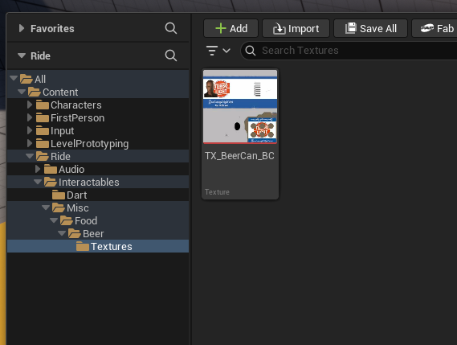
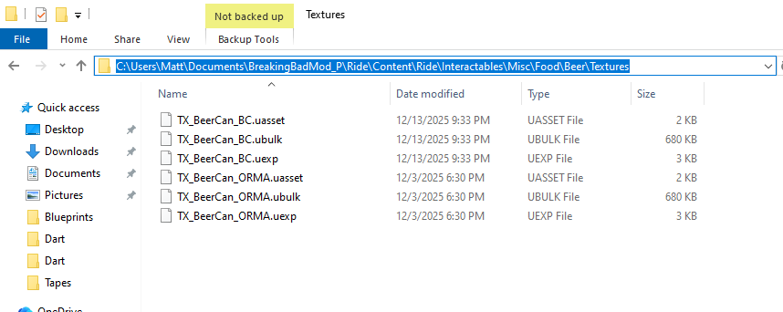
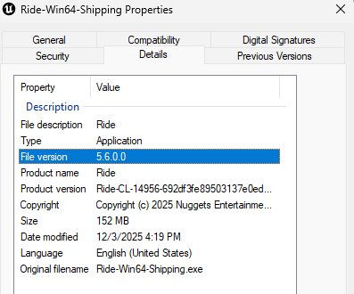
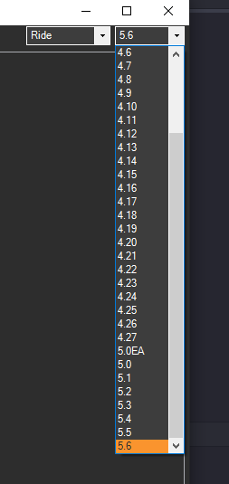
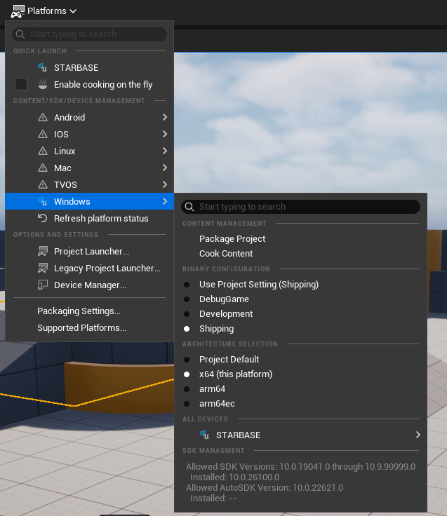

# RV There Yet - Breaking Bad Mod

> Disclaimer: This project was created strictly for educational purposes as part of university coursework. *RV There Yet?* is owned by Nuggets Entertainment, and *Breaking Bad* is owned by Sony Pictures Television. No proprietary game files or copyrighted assets are distributed on this site.

## Time Taken
- 2 Weeks

## Overview
The mod `RV There Yet - Breaking Bad Mod` allows those to spice up their gameplay by changing game assets to reference the popular television series `Breaking Bad`, created by Vince Gilligan. This mod was created as part of a Reverse Engineering project at the University of Tulsa.

## Objectives
- Change the sounds of tapes in-game
- Rename items to be Breaking Bad themed
- Change cassette tape captions
- Modify in-game textures

## Terminology
- Unreal Engine: A popular game engine used for creating video games developed by Epic Games.
- Cooked Content: Unreal Engines compiled files for game assets.
- IoStore: An Unreal Engine file format for packaging cooked game assets.

## Key Technologies/Tools Used
- [UE_Modding Github Wiki](https://github.com/Dmgvol/UE_Modding)
- [UAssetGUI v1.0.4](https://github.com/atenfyr/UAssetGUI)
- [Retoc](https://github.com/trumank/retoc)
- [RE-UE4SS](https://github.com/UE4SS-RE/RE-UE4SS)
- [FModel](https://fmodel.app/)
- Unreal Engine 5.6

## Challenges
When I began the project, the first main challenge I ran into was searching for good guides/information online on how to mod Unreal Engine based games. I found many tutorials for Unreal Engine 4, I found many fewer tutorials for Unreal Engine 5, let alone Unreal Engine 5.6 which RV There Yet utilizes.

The second challenge was finding tools that were compatible with Unreal Engine 5.6. Luckily the main tool that I used, `UAssetGUI` released an updated/experimental version compatible with Unreal Engine 5 a couple days into starting the project which quite literally saved me.

My third challenge was I struggled initially to change in-game textures. I found where the textures were located and was successfully able to export textures as a `.png` and modify the image, but when I cooked the file and imported it into the game for some reason the game never overwrites the original file. My first thought was that I just needed to clear my graphics cache which I was able to do by deleting files located in my Nvidia graphics card cache folder `C:\Users\<username>\AppData\Local\NVIDIA\DXCache`. However, upon restarting the game and with the recompiled graphics the modified file was never changed. 

After failing, I tried one last hail mary and for an unknown reason whenever I recreated the exact same folder structure that is found in the game into Unreal Engine and then cook the file, it would work. So, my understanding is that Unreal Engine saves some sort of file path to the cooked asset and since I did not have that at first whenever the game was deciding whether to import the mod it would deny it, but with the folder path created in Unreal Engine it would import the mod into the game.

Example of the folder structure in Unreal Engine:

Example of the same texture in the Mod folder:

Overall, once I figured how to implement the Pak Patching method along with understanding specific file settings and structure through hours of debugging I was then able to successfully create the Breaking Bad mod.

## Results/Findings
### How to Mod
To begin modding there are multiple ways that I found online that can be used to complete this goal. For this project I used one method named `Pak Patching`.

For context, Unreal Engine puts all game assets, models, sounds, and game structure in a singular `.pak` file. A pak file can be interpreted as a zip file containing all the cooked game files usually stored in the pak file as a `.uasset` file.

In the case of RV There Yet with it using Unreal Engine 5.6, when the developers were building the game files they used an option to use an IoStore which is just another format they use for packing game content. An IoStore can be detected if there are `.utoc` and `.ucas` files located in the games content folder located `{Steam}\Ride\Ride\Content\Paks`.

So, to mod a game using the IoStore format you have to use a tool named `Retoc` to convert the game assets from their current version to an older legacy format. This will also unpack the file allowing you to see all the `.uasset` files in the game. 
1. Install [Retoc](https://github.com/trumank/retoc)
2. Open Powershell and enter the folder of the program installed
3. Run `.\retoc.exe to-legacy --no-shaders <Content Paks Folder> --version <version> <output_folder>`
	- Content Paks Folder: Path to the Content Paks folder in your Unreal Game
	- Version: Unreal engine version such as `UE5_6`
	- Filter: You can apply a filter as well if you don't wish to convert the entire file. 
	- Output Folder: Can be named whatever but it has to have `_P` as the suffix. This essentially allows the mod since the engine will overwrite the original game files with those contained in this folder.
4. You now have your converted files

Now that you have the unpacked game files, you then have to create a game mapping file. After research it turns out Unreal Engine needs a file which essentially is an index for all assets packaged into a game allowing the engine to know where data is located. There is no easy way to get this mapping from the game files itself so I found a tool named [RE-UE4SS](https://github.com/UE4SS-RE/RE-UE4SS) which allows you to extract the mapping file when the game program is running.
1. Download [RE-UE4SS](https://github.com/UE4SS-RE/RE-UE4SS)
2. Extract the downloaded files into the game binaries folder `{Steam}\{GameName}\{GameName}\Binaries\Win64\`
3. Edit the UE4SS config in the file `UE4SS-settings.ini` to have the following values
	- `[EngineVersionOverride]` MajorVersion and MinorVersion fields to be the version of Unreal Engine the game runs so this case 5 and 6.
	- Under the `[Debug]` section ensure ConsoleEnabled, GuiConsoleEnabled, and GuiConsoleVisible all have the value of 1.
4. Launch your game
	- You will see a pop-up that is normal
5. Open the GUI console named debugging tools and select `Dumpers -> Generate .usmap file`
6. Done, there should now be a mappings file located in `{Steam}\{GameName}\{GameName}\Binaries\Win64\Mappings.usmap`

After unpacking and converting the type you can view the game asset data using FModel or UAssetGUI.

#### View Game Assets
1. Install [FModel](https://fmodel.app/)
2. Open FModel
	- Add Undetected Game
		1. Name being Game name so `Ride`
		2. Path to the Content Paks folder `{Steam}\{GameName}\{GameName}\Content\Paks`
		3. Set UE Version to the games unreal engine version which can be found by clicking `Properties` on the file `{Steam}\{GameName}\{GameName}\Binaries\Win64\<GameName>-Win64-Shipping.exe`
			
	- Open the game archive. 
		1. Different unreal games might be configured differently but RV There Yet uses an IOStore. So if there are any .utoc files in the Content Paks folder then your game uses the IOStore. FModel can open this file it just can't edit or view the details of a file

#### Modify Game Assets with UAssetGUI
1. Install the [latest experimental version v1.0.4](https://github.com/atenfyr/UAssetGUI/releases/tag/experimental-latest) to work with Unreal Engine 5.6
2. Open UAssetGUI
3. Select Engine 5.6 (or whichever needed for your game)

4. Then import the mapping file from earlier by going to `Utils -> Import Mappings`
5. Now feel free to edit anything that you would like.
    - NOTE: UAssetGUI will create a `.bak` file every time you save. Ensure those files are deleted. They usually are located within the folder where the file was just edited.

#### Replace Audio Files
1. Find the audio file you wish to replace. This will usually be a `.uasset` file with the type set to `Soundwave`
2. Find the length of the original sound file using FModel or UAssetGUI and create a replacement audio file similar to the same length. The type has to be a `.wav` file.
3. Open Unreal Engine using the same version of the game i.e., UE 5.6
    - Drag and drop your new `.wav` audio file into the Content Drawer
    - Right click the imported audio file and select `Edit`
    - Under `Format -> Sound Asset Compression Type` set the value to be `Bink Audio`. This was found during the export of the old file and using FModel or UAssetGUI and finding metadata referencing this compression type.
    - Now under the `Platforms` dropdown at the top of the screen set the following options and click `Cook Content`.
    
4. Now using file explorer go to your Unreal project folder usually in your documents folder `Documents\Unreal Projects\Ride\Saved\Cooked\Windows\Ride\Content\` and copy the `.uasset`, `.ubulk`, and `.uexp`files to the mod folder such as `BreakingBadMod_P\Ride\Content\Ride\Audio\AudioFiles\Tapes\`

#### Replace Textures
Lastly, if you want to modify in game textures follow the steps below. The guide essentially is very similar to how an audio file is replaced except you need to export the original texture, modify it, then import into Unreal Engine with specific settings configured and just cook the file and import into your mod folder.
1. Using FModel find the Texture2D file you wish to replace.
2. Right click the file and select `Save Texture`. Then go to the FModel export folder and grab the `.png` file that it was exported as.
3. Make any changes you want to the image but do not change the image size, type, or alpha.
4. Then recreate the folder path in Unreal which in this games case for the Beer package was `Content\Ride\Interactables\Misc\Food\Beer\Textures\`.
5. Drag and drop the modified file into the new folder.
6. Ensure the following options are set in Unreal by clicking the `Edit` button on the texture:
    - Mip Gen Settings = FromTextureGroup
    - Texture Group = World
    - Compress Without Alpha = Enabled
    - Compression Settings = Default (BC1 or BC3 with A)
    - Virtual Texture Streaming = Off
    - sRGB = Enabled
7. Cook the assets and copy the 3 cooked files into your mod folder.

### Modded Files

Modified the cassette tape `Absolute Calm - Intro` captions to be a description of what Breaking Bad is about. ChatGPT was used to generate a script as 37 lines were needed to replace the old cassette tape captions.

Modified the display names for interactable objects in game by modifying the `DisplayName` field within UAssetGUI.

| Object | Old Name | New Name |
| ------ | -------- | -------- |
| Cassette Tape | Absolute Calm - Intro | Breaking Bad - Summary |
| Winch Controller | Winch Controller | Heisenwinch |
| EpiPen | EpiPen | Meth |
| WalkieTalkie | WalkieTalkie | Walter's Phone |
| Beer Can | Beer | HeisenBrew |
| Map | Map | Meth Lab Map |
| Antidote | Antidote | Walter Water |
| DartBoard | DartBoard | Hank's Dart Board |

Other Modifications:
- Modified the sounds for `AC_Lesson0_Intro` to the intro music to Breaking Bad.
- Modified the sounds for `Cassette_RelaxEmbrace` to be `Negro Y Azul: The Ballad of Heisenberg`.
- Changed the texture for the Dart Board in game.
- Changed the Beer can package to include an image of Jesse Pinkman's face from Breaking Bad.

## Conclusion
This project introduced me into the world of game modding and I can say I happily enjoyed making mods for `RV There Yet`, and I hope I can spend more time modding this game and others. Specifically, this project introduced me into how Unreal Engine games are created/structured and how to use tools specific to Unreal Engine to successfully create mods.

## AI Statement
In this project the only use of AI was to generate the Breaking Bad themed Cassette Tape captions using ChatGPT because I needed specifically 37 lines. Other than that no other usage of AI was used in my part of the project.

## References
- [UE_Modding Github Wiki](https://github.com/Dmgvol/UE_Modding)
- [UAssetGUI v1.0.4](https://github.com/atenfyr/UAssetGUI)
- [Retoc](https://github.com/trumank/retoc)
- [RE-UE4SS](https://github.com/UE4SS-RE/RE-UE4SS)
- [FModel](https://fmodel.app/)
- [Basics of Unreal Engine 4 Modding - Youtube](https://youtu.be/ZZrEZMi6X5o?si=KkBPABgJufE1Aq-8)